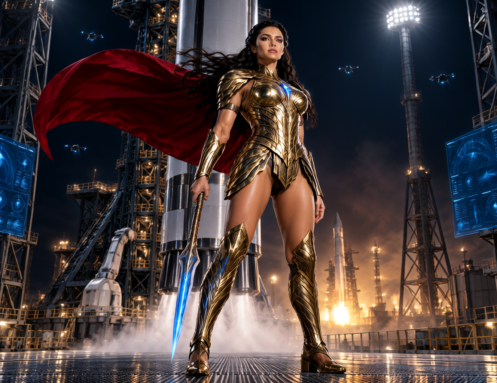

# Realistic MOSS — AI Image Generation

A local AI image-generation project created using the MOSS workflow in ComfyUI on Apple Silicon.

## Generated Image Gallery

### Image 1

### Image 2

### Image 3

## ComfyUI Workflow

The workflow used for this project is included here:

[Real Iss MOSS Workflow JSON](workflows/Real_Iss_MOSS.json)

To use it, open the JSON in ComfyUI and configure the required models and paths for your installation.

**Note:** Model weights are not included in this repository.

## Environment

- Interface: ComfyUI
- Workflow: Real Iss MOSS
- Hardware: Apple Silicon MacBook Pro M4 Max
- Output: AI-generated images

## Author

Created as part of my exploration of local generative AI and AI-assisted visual storytelling.
